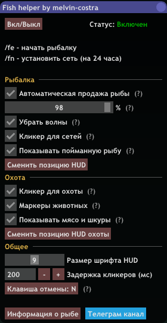
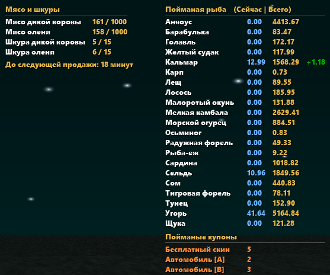

# 🎣 Скрипт для рыбалки и охоты (Samp-Rp)

Lua-скрипт для проекта Samp-Rp, который автоматизирует рыбалку и охоту: авто-продажа рыбы по ценовому порогу, авто-оснащение удочки, установка сетей, кликеры для сетей и охоты, маркеры животных на миникарте, а также два настраиваемых HUD с информацией о пойманной рыбе и ресурсах охоты.

## 📥 [**Скачать script.zip**](https://github.com/melvin-costra/fish-helper/releases/latest/download/script.zip)

> После скачивания перенеси файлы из архива в папку `moonloader`.

  
  

---

## 🔧 Функции

### Рыбалка
- **Автоматическая продажа** — автоматически продаёт рыбу в магазине, если её цена **выше или равна** указанному порогу от максимальной цены. В окне продажи подсвечивается текущая и максимальная цена каждой рыбы.
  > Например: если максимальная цена Сома — `1000`, а в магазине она составляет `800` (80%), то для запуска продажи **необходимо** установить порог **не ниже 80%**.
- **Убрать волны** — убирает волны на воде, чтобы не было тряски лодки
- **Кликер для сетей** — автоматически кликает по рыбам при сборе сети
- **HUD пойманной рыбы** — показывает список пойманной рыбы: сколько поймано за сессию и всего, изменения отображаются динамически. Также отслеживает полученные купоны (скин, авто [A], авто [B]). Обновляется командой `/fish inv`
- **Информация о рыбе** — выводит полную информацию обо всей рыбе в чат (цены, локация, время клёва — аналог `/fish journal`, но с ценами)
- **Автоматическое оснащение** — автоматически оснащает удочку, снасть и наживку при поломке (работает при включении скрипта)
- **Автоматическая установка сетей** — автоматически устанавливает рыболовные сети (работает по команде `/fn`)

### Охота
- **Кликер для охоты** — автоматически кликает по точкам при свежевании животного
- **Маркеры животных** — отображает маркеры оленей и диких коров на миникарте
- **HUD мяса и шкур** — показывает количество мяса и шкур с лимитами, а также таймер доступности продажи шкур. Обновляется командой `/inventory`

### Общее
- **Клавиша отмены** — настраиваемая клавиша (по умолчанию `N`) для остановки продажи, оснащения и установки сетей
- **Задержка кликеров** — настраиваемая задержка автоматических кликов (в миллисекундах)
- **Размер шрифта HUD** — настройка размера шрифта обоих HUD
- **Перетаскивание HUD** — позицию каждого HUD можно менять прямо на экране

---

## ▶ Команды

- `/fh` - открыть/закрыть окно настроек скрипта
- `/fe` - начать рыбалку
- `/fn` - установить рыболовные сети

## 📢 Связь

Подпишись на мой телеграмм канал и будь в курсе обновлений - [@melvin_costra](https://t.me/melvin_costra)

Мой телеграм - [@vovka8101](https://t.me/vovka8101)
